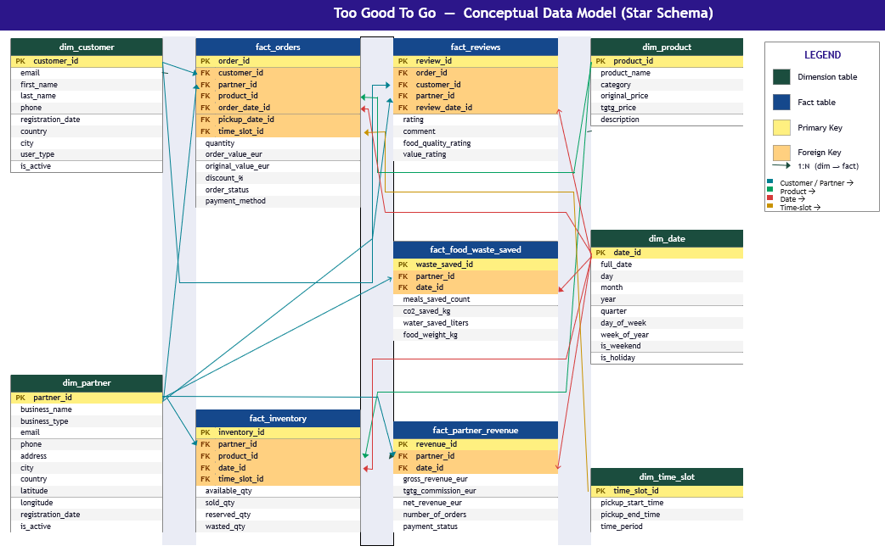
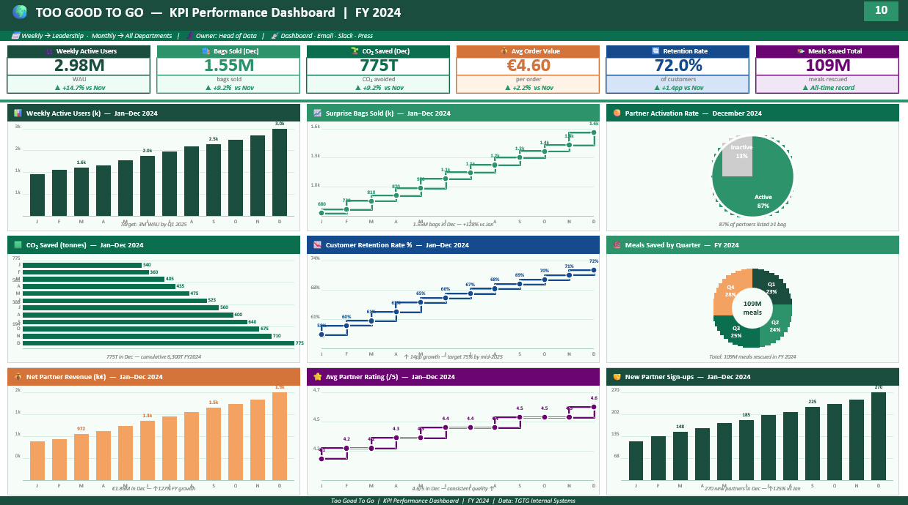
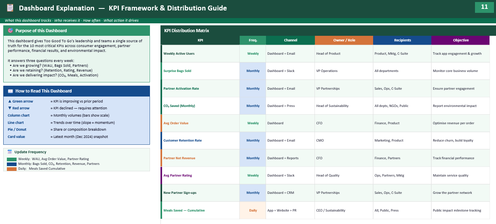

# 🌍 Too Good To Go: Enterprise Data Strategy & Architecture

## 📌 Project Overview
[cite_start]This repository contains a comprehensive enterprise data strategy and architectural framework developed for **Too Good To Go**, the world's leading food-waste reduction platform[cite: 23]. 

[cite_start]The primary objective of this project is to address the data engineering and governance challenges associated with capturing, synchronising, and standardising partner data at scale[cite: 29]. [cite_start]By designing a robust data infrastructure, this framework ensures real-time inventory accuracy across 150,000+ independent partner stores, preventing double-bookings and improving demand forecasting [cite: 34-40].

*This project was completed as part of the MSc in Data Analytics for Business at KEDGE Business School.*

---

## 🏗️ Core Architecture & Conceptual Data Model

[cite_start]Ingesting transaction data from dozens of different Point-of-Sale (POS) systems into a single clean schema is a major engineering challenge [cite: 42-44]. [cite_start]To solve this, we designed a **Conceptual Data Model (Star Schema)**[cite: 245].

This schema normalises the data ecosystem by linking critical dimension tables (Customers, Partners, Products, Dates) with central fact tables capturing:
* [cite_start]Real-time inventory and reserved quantities [cite: 307-309].
* [cite_start]Order transactions and payment statuses [cite: 275, 290-295].
* [cite_start]Environmental impact metrics (CO₂ saved, water saved) [cite: 326, 333-335].

*(Fig 1: The Star Schema linking dimensions and fact tables to support enterprise reporting and real-time operations.)*

---

## 📊 Business Intelligence & KPI Dashboard

[cite_start]To provide leadership with a single source of truth, we developed a **KPI Performance Dashboard**[cite: 619]. [cite_start]This dashboard tracks the 10 most critical metrics across consumer engagement, financial results, and sustainability impact[cite: 619].

Key metrics tracked include:
* [cite_start]**Growth:** Weekly Active Users (WAU), Surprise Bags Sold, New Partner Sign-ups[cite: 621].
* [cite_start]**Retention:** Customer Retention Rate, Avg Partner Rating[cite: 622].
* [cite_start]**Impact:** Cumulative Meals Saved, CO₂ Avoided (Tonnes)[cite: 623].

*(Fig 2: FY 2024 KPI Performance Dashboard visualising momentum and growth trends.)*

---

## 📋 KPI Distribution Framework

Data is only valuable if it reaches the right stakeholders at the right time. [cite_start]We mapped a complete **KPI Distribution Matrix** to govern how these metrics are shared across the organisation[cite: 641]. 

[cite_start]This matrix dictates the frequency, distribution channel, ownership, and strategic objective for every KPI [cite: 642-647]. [cite_start]For example, the Head of Sustainability owns the monthly reporting of CO₂ saved to ensure public and NGO transparency, while the Head of Product monitors Weekly Active Users to track app engagement [cite: 648-653, 666-671].

*(Fig 3: The internal distribution guide aligning data outputs with departmental actions.)*

---

## 🛠️ Concepts & Methodologies Applied
* **Data Modeling:** Star Schema Design, Fact & Dimension Table Structuring, Primary/Foreign Key Mapping.
* [cite_start]**Systems Architecture:** Software Dependency Mapping, Physical-to-Digital Data Capture (IoT, POS, API) [cite: 46-101].
* [cite_start]**Business Intelligence:** Executive Dashboarding, Trend Analysis, ESG / B-Corp Reporting Integration [cite: 231, 629-636].

---

## 👨‍💻 Authors & Acknowledgements
* **Vighnesh Shetty** - *Data Strategy & Architecture*
* [cite_start]**Mohit Bahukhandi** - *Data Strategy & Architecture* [cite: 25-27]
* [cite_start]**Project Supervisor:** Prof. Antoine Jeanjean [cite: 149]

---
*Too Good To Go exists to eliminate food waste globally. Every day, perfectly edible food is discarded — they're changing that, one rescued meal at a time.* [cite: 15-16]
